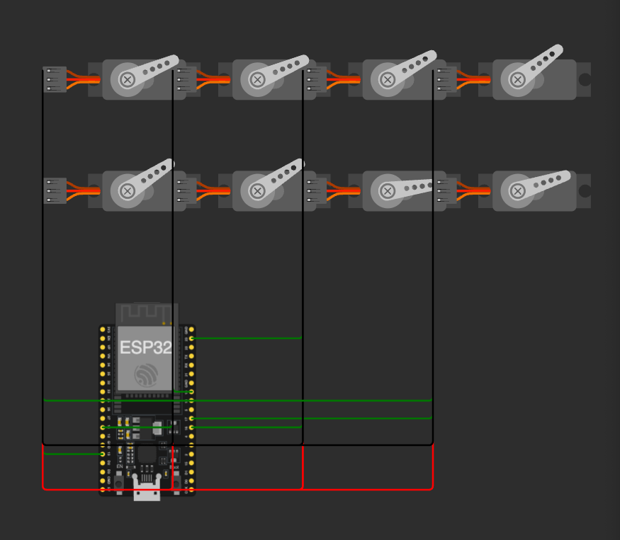

# AI Autobiography

> Una pieza física que se mueve sola, cada día, según lo que pasa en el mundo de la inteligencia artificial.

🚧 **En construcción.** Qué será exactamente se irá viendo poco a poco.

## Qué hay por ahora

Un ESP32 que controla 8 servomotores. Cada día recibirá un único número y lo traducirá a una posición para cada motor. De momento todo funciona en simulación, antes de pasar al montaje real.



*Primer esquema en [Wokwi](https://wokwi.com): un ESP32 DevKit con 8 servos SG90.*

## Hardware (provisional)

- ESP32 DevKit
- 8 × servo SG90
- Fuente de 5 V independiente para los servos (en el montaje real no se alimentan del ESP32)

## Cómo probarlo

Requisitos: [PlatformIO](https://platformio.org) y, para simular, la extensión **Wokwi Simulator** de VS Code o [wokwi-cli](https://docs.wokwi.com/wokwi-ci/getting-started).

```bash
# Compilar
pio run

# Simular (con interfaz): en VS Code, F1 → "Wokwi: Start Simulator"
# Simular (en terminal, 10 s):
wokwi-cli --timeout 10000 .
```

Por el monitor serie (115200 baudios) se ve la posición que recibe cada motor.

## Estructura

```
src/main.cpp     firmware del ESP32
diagram.json     circuito de la simulación en Wokwi
wokwi.toml       configuración del simulador
images/          fotos y esquemas del proceso
```

## Progreso

- [x] Simulación de los 8 servos con el ESP32
- [ ] Cálculo de la posición de cada motor
- [ ] La fuente del número diario
- [ ] Piezas en 3D
- [ ] Montaje real

---

Hecho por [@rauleteee](https://github.com/rauleteee).
